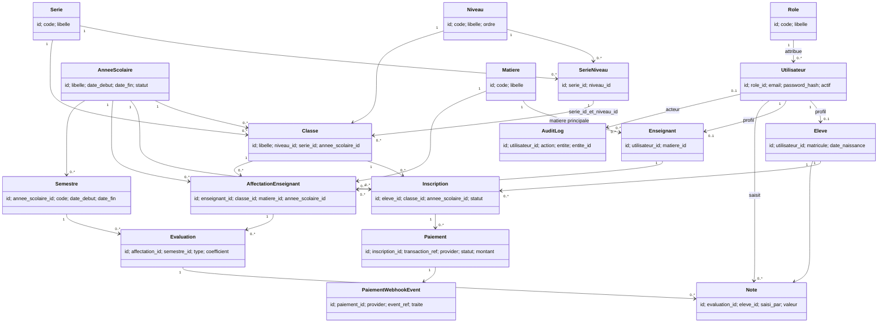
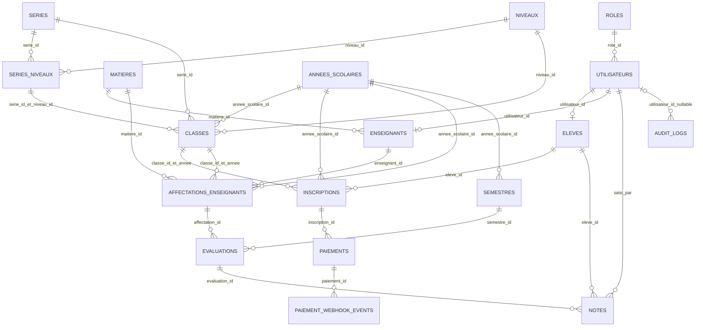

# Proposition de documentation du schema

> **Document historique :** cet audit décrit l'état des migrations avant la correction finale. Ses constats et diagrammes ne sont plus la référence du schéma courant. Utiliser [la documentation technique](../technique/schema-base-de-donnees.md), les [diagrammes UML](../uml/diagramme-classes.mmd) et le [rapport final](../rapports/audit-final-migrations.md). Ce document reste conservé comme trace de l'analyse préliminaire et ne constitue pas une spécification fonctionnelle approuvée.

## Perimetre et sources

Sources examinees : le README, les 12 migrations SQL, les fichiers PHP presents, les configurations Docker/Nginx/PHP et les variables d'environnement d'exemple. Le fichier `.env` local n'a pas ete lu.

Aucun cahier des charges, diagramme UML, documentation technique complete, donnees de seed, code de test ou mecanisme de migration n'a ete trouve. Les dossiers `Models`, `Repositories`, `Services`, `Validators`, `Middleware`, les vues par role, `routes`, `database/seeds` et les dossiers de tests sont presents mais vides.

Le code PHP se limite a une route `GET /`, un routeur, un controleur d'accueil et son gabarit. Il ne contient pas de connexion a PostgreSQL ni de logique metier pour les inscriptions, notes, paiements ou audits. Les regles ci-dessous sont donc celles exprimees par le schema SQL, pas des regles confirmees par une implementation applicative.

## Architecture observee

`docker-compose.yml` orchestre Nginx 1.27, PHP-FPM 8.5 et PostgreSQL 16. Le navigateur accede a Nginx via le port 8080 ; PHP installe `pdo_pgsql`, mais le depot ne contient pas de code qui l'utilise. PostgreSQL publie son port 5432 sur l'interface locale uniquement. Le fichier `.env` est passe au conteneur de base de donnees ; aucun chargement de configuration DB cote PHP n'est present. Nginx renvoie les chemins non statiques a `public/index.php`. Aucune configuration n'execute automatiquement les migrations. Le README mentionne Bootstrap, mais aucun asset ou gestionnaire de dependances frontend n'est present.

## Inventaire des tables

Les 12 migrations definissent 18 tables : `roles`, `utilisateurs`, `annees_scolaires`, `niveaux`, `series`, `series_niveaux`, `classes`, `matieres`, `eleves`, `enseignants`, `inscriptions`, `affectations_enseignants`, `semestres`, `evaluations`, `notes`, `paiements`, `paiement_webhook_events` et `audit_logs`.

## Dictionnaire de donnees

Notation : `!` signifie `NOT NULL`, `?` signifie nullable. `IDENTITY` indique une colonne generee automatiquement. Les valeurs par defaut et cles sont indiquees lorsqu'elles sont definies dans les migrations.

| Table | Colonnes (type, nullabilite, defaut) |
|---|---|
| `roles` | `id SMALLINT! IDENTITY PK`; `code VARCHAR(30)!`; `libelle VARCHAR(100)!`; `description TEXT?`; `created_at TIMESTAMPTZ! DEFAULT CURRENT_TIMESTAMP` |
| `utilisateurs` | `id INTEGER! IDENTITY PK`; `role_id SMALLINT! FK`; `nom VARCHAR(100)!`; `prenom VARCHAR(100)!`; `email VARCHAR(255)! UNIQUE`; `password_hash VARCHAR(255)!`; `actif BOOLEAN! DEFAULT TRUE`; `created_at TIMESTAMPTZ! DEFAULT CURRENT_TIMESTAMP`; `updated_at TIMESTAMPTZ! DEFAULT CURRENT_TIMESTAMP` |
| `annees_scolaires` | `id SMALLINT! IDENTITY PK`; `libelle VARCHAR(20)! UNIQUE`; `date_debut DATE!`; `date_fin DATE!`; `statut VARCHAR(15)! DEFAULT 'A_VENIR'`; `created_at TIMESTAMPTZ! DEFAULT CURRENT_TIMESTAMP` |
| `niveaux` | `id SMALLINT! IDENTITY PK`; `code VARCHAR(20)! UNIQUE`; `libelle VARCHAR(100)! UNIQUE`; `ordre SMALLINT!` |
| `series` | `id SMALLINT! IDENTITY PK`; `code VARCHAR(20)! UNIQUE`; `libelle VARCHAR(100)! UNIQUE` |
| `series_niveaux` | `id INTEGER! IDENTITY PK`; `serie_id SMALLINT! FK`; `niveau_id SMALLINT! FK`; unicite de la paire `(serie_id, niveau_id)` |
| `classes` | `id INTEGER! IDENTITY PK`; `libelle VARCHAR(100)!`; `niveau_id SMALLINT! FK`; `serie_id SMALLINT! FK`; `annee_scolaire_id SMALLINT! FK`; unicite de `(libelle, annee_scolaire_id)` |
| `matieres` | `id SMALLINT! IDENTITY PK`; `code VARCHAR(20)! UNIQUE`; `libelle VARCHAR(100)! UNIQUE`; `description TEXT?`; `created_at TIMESTAMPTZ! DEFAULT CURRENT_TIMESTAMP` |
| `eleves` | `id INTEGER! IDENTITY PK`; `utilisateur_id INTEGER! FK UNIQUE`; `matricule VARCHAR(20)! UNIQUE`; `date_naissance DATE!`; `created_at TIMESTAMPTZ! DEFAULT CURRENT_TIMESTAMP` |
| `enseignants` | `id INTEGER! IDENTITY PK`; `utilisateur_id INTEGER! FK UNIQUE`; `matiere_id SMALLINT! FK`; `created_at TIMESTAMPTZ! DEFAULT CURRENT_TIMESTAMP` |
| `inscriptions` | `id INTEGER! IDENTITY PK`; `eleve_id INTEGER! FK`; `classe_id INTEGER!`; `annee_scolaire_id SMALLINT!`; FK composite `(classe_id, annee_scolaire_id)`; unicite `(eleve_id, annee_scolaire_id)`; `statut VARCHAR(20)! DEFAULT 'PENDING'`; `date_inscription DATE! DEFAULT CURRENT_DATE`; `created_at`, `updated_at TIMESTAMPTZ! DEFAULT CURRENT_TIMESTAMP` |
| `affectations_enseignants` | `id INTEGER! IDENTITY PK`; `enseignant_id INTEGER! FK`; `classe_id INTEGER!`; `matiere_id SMALLINT! FK`; `annee_scolaire_id SMALLINT!`; FK composite `(classe_id, annee_scolaire_id)`; unicite `(enseignant_id, classe_id, matiere_id, annee_scolaire_id)`; `created_at TIMESTAMPTZ! DEFAULT CURRENT_TIMESTAMP` |
| `semestres` | `id SMALLINT! IDENTITY PK`; `annee_scolaire_id SMALLINT! FK`; `code VARCHAR(10)!`; `libelle VARCHAR(100)!`; `date_debut`, `date_fin DATE!`; `created_at`, `updated_at TIMESTAMPTZ! DEFAULT CURRENT_TIMESTAMP`; unicite `(code, annee_scolaire_id)`, `(libelle, annee_scolaire_id)` et `(id, annee_scolaire_id)` |
| `evaluations` | `id INTEGER! IDENTITY PK`; `affectation_id INTEGER! FK`; `semestre_id SMALLINT! FK`; `libelle VARCHAR(150)!`; `type VARCHAR(20)!`; `coefficient NUMERIC(5,2)! DEFAULT 1.00`; `date_evaluation DATE!`; `description TEXT?`; `created_at`, `updated_at TIMESTAMPTZ! DEFAULT CURRENT_TIMESTAMP`; unicite `(id, affectation_id)` |
| `notes` | `id INTEGER! IDENTITY PK`; `evaluation_id INTEGER! FK`; `eleve_id INTEGER! FK`; `valeur NUMERIC(5,2)!`; `commentaire TEXT?`; `saisi_par INTEGER! FK vers utilisateurs`; `date_saisie`, `created_at`, `updated_at TIMESTAMPTZ! DEFAULT CURRENT_TIMESTAMP`; unicite `(evaluation_id, eleve_id)` |
| `paiements` | `id INTEGER! IDENTITY PK`; `inscription_id INTEGER! FK`; `transaction_ref VARCHAR(100)! UNIQUE`; `provider_transaction_ref VARCHAR(150)?`; `provider VARCHAR(20)!`; `statut VARCHAR(20)! DEFAULT 'INITIE'`; `montant NUMERIC(12,2)!`; `devise CHAR(3)! DEFAULT 'XOF'`; `description TEXT?`; `date_initiation`, `created_at`, `updated_at TIMESTAMPTZ! DEFAULT CURRENT_TIMESTAMP`; `date_paiement`, `date_remboursement TIMESTAMPTZ?`; unicite `(provider, provider_transaction_ref)` |
| `paiement_webhook_events` | `id INTEGER! IDENTITY PK`; `paiement_id INTEGER! FK`; `provider VARCHAR(20)!`; `event_ref VARCHAR(150)!`; `type_evenement VARCHAR(100)!`; `payload JSONB!`; `signature_verifiee BOOLEAN! DEFAULT FALSE`; `traite BOOLEAN! DEFAULT FALSE`; `date_reception TIMESTAMPTZ! DEFAULT CURRENT_TIMESTAMP`; `date_traitement TIMESTAMPTZ?`; unicite `(provider, event_ref)` |
| `audit_logs` | `id INTEGER! IDENTITY PK`; `utilisateur_id INTEGER? FK`; `action VARCHAR(100)!`; `entite VARCHAR(100)!`; `entite_id INTEGER?`; `anciennes_donnees`, `nouvelles_donnees JSONB?`; `adresse_ip INET?`; `user_agent TEXT?`; `request_id VARCHAR(100)?`; `created_at TIMESTAMPTZ! DEFAULT CURRENT_TIMESTAMP` |

## Proposition de diagramme de classes UML

Les classes ci-dessous representent les tables. Les identifiants et attributs de liaison sont affiches pour garder le diagramme lisible ; le dictionnaire ci-dessus donne la liste complete des colonnes. Les multiplicités traduisent les FK, nullabilites et unicites actuelles. La contrainte unique proposee pour `classes(id, annee_scolaire_id)` est necessaire aux deux FK composites d'inscription et d'affectation.

## Diagramme des relations entre tables

## Contraintes importantes constatees

- **Roles et comptes** : `roles.code` suit `^[A-Z_]+$` et `roles.libelle` est limite a `ADMIN`, `DIRECTEUR`, `ENSEIGNANT` ou `ELEVE`. L'email utilisateur doit deja etre en minuscules, sans espaces de bord et non vide. Le hash doit commencer par `$argon2id$`. Aucune migration de seed ne cree les roles.
- **Annees et classes** : une annee doit finir apres son debut ; son libelle doit avoir la forme `AAAA-AAAA` avec deux annees consecutives. Les statuts permis sont `A_VENIR`, `EN_COURS` et `TERMINEE`; l'index partiel garantit au plus une annee `EN_COURS`. Une classe doit utiliser une paire serie/niveau inscrite dans `series_niveaux`; le libelle est unique par annee. `niveaux.ordre` doit etre positif.
- **Correction structurelle a valider** : les migrations 006 et 007 referencent `classes(id, annee_scolaire_id)`, mais la migration 004 ne declare pas cette paire unique. PostgreSQL exige une cle primaire ou contrainte unique sur les colonnes cible exactes d'une FK composite. La migration 004 declare seulement `id` comme cle primaire et `(libelle, annee_scolaire_id)` comme paire unique. Proposition purement structurelle : ajouter `UNIQUE (id, annee_scolaire_id)` a `classes`. Cela autorise les deux FK telles qu'ecrites et conserve leur intention apparente de verifier que l'inscription ou l'affectation correspond a l'annee de la classe, au prix d'un index unique redondant sur une colonne deja identifiee par sa cle primaire. Ne pas appliquer sans choisir la strategie de versionnement : modifier 004 convient uniquement si ces migrations ne sont pas deja partagees/appliquees ; sinon, une migration corrective et une strategie d'application sont necessaires. Aucun outil de migration n'est present dans le depot.
- **Donnees eleves** : le matricule suit `LYC-AAAA-NNNNN`. La contrainte de date de naissance n'impose que `date_naissance < 2100-01-01`; elle autorise donc des dates futures et n'exprime pas une limite d'age evidente. Le sens attendu doit etre confirme avant de la modifier.
- **Inscriptions** : un eleve ne peut avoir qu'une inscription par annee ; les statuts sont `PENDING`, `PAYE` ou `ANNULEE`, et `date_inscription` ne peut preceder 2000-01-01. Le schema n'impose pas qu'une inscription soit liee a une classe dont la periode ou le statut d'annee autorise l'inscription.
- **Semestres et evaluations** : le code semestre est `S1` ou `S2`; les periodes d'une meme annee ne peuvent pas se chevaucher et un trigger les borne aux dates de l'annee scolaire. Une evaluation accepte `DEVOIR` ou `COMPOSITION` et un coefficient strictement positif. Le schema ne garantit pas que son semestre appartienne a la meme annee que son affectation.
- **Notes** : une note est entre 0 et 20 et un eleve ne peut avoir qu'une note par evaluation. Aucune FK ne verifie que l'eleve est inscrit dans la classe de l'affectation de l'evaluation.
- **Paiements** : montant positif ; prestataire `WAVE` ou `CARTE`; devise au format de trois lettres ; etats et dates soumis a des checks. Les webhooks sont dedupliques par `(provider, event_ref)`. Le trigger/check SQL ne verifie pas lui-meme une signature cryptographique ni l'origine du prestataire.
- **Confirmation de paiement** : `confirmer_paiement` verrouille le paiement et l'inscription, accepte seulement les paiements `INITIE` ou `EN_ATTENTE` et les inscriptions `PENDING`, puis marque les deux `PAYE`. L'appel est idempotent si le paiement est deja `PAYE`. Le commentaire SQL indique que la fonction doit etre appelee apres confirmation fiable par le service PHP, mais ce service n'existe pas encore.
- **Audit** : les triggers interdisent `UPDATE`, `DELETE` et `TRUNCATE`; les droits sont retires a `PUBLIC`. Cela ne garantit pas l'immutabilite contre le proprietaire de la table ou un superutilisateur qui peut modifier les triggers ou permissions.

## Ambiguites a faire valider

1. Faut-il imposer que l'annee du semestre d'une evaluation soit celle de son affectation ? La structure actuelle ne l'impose pas.
2. Une note doit-elle etre autorisee uniquement si l'eleve a une inscription valide dans la classe concernee et pour l'annee de l'affectation ? Aucune regle correspondante n'est exprimee dans les migrations.
3. La matiere d'une affectation doit-elle obligatoirement etre la matiere principale du profil enseignant ? Le schema autorise des valeurs differentes.
4. Un utilisateur peut-il avoir simultanement un profil eleve et enseignant, ou faut-il faire correspondre le role au profil specialise ? Les FK et unicites actuelles ne l'interdisent pas.
5. Quelle regle de validite d'age et de date de naissance est attendue ? La limite fixe a 2100 ne permet pas de la deduire.
6. Quelle politique definir pour les dates des annees scolaires : correspondance entre libelle et dates, absence de chevauchement, et bornes inclusives/exclusives ? Ces regles ne sont pas toutes imposees.
7. Quelles transitions d'etat, conditions de remboursement, verification de webhook et permissions de paiement sont attendues ? Le SQL ne definit qu'une partie du cycle de vie.
8. Les migrations peuvent-elles etre modifiees, ou ont-elles deja ete appliquees dans un environnement partage ? Le depot ne contient pas de registre de migrations pour le determiner.

Ces points sont des questions, pas des recommandations fonctionnelles imposees. Les diagrammes representent uniquement les relations actuelles et la correction technique proposee pour la cle composite de `classes` ; ils n'ajoutent pas les relations fonctionnelles encore a confirmer.